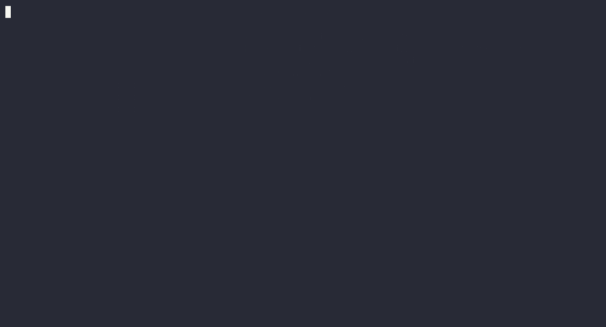

# termux-fastfetch-rotator

Artes ASCII de distros que **rotan en cada `clear`** (y al abrir la terminal) usando [fastfetch](https://github.com/fastfetch-cli/fastfetch) en **Termux**.



Incluye 19 logos: BlackArch, Arch, Debian, Ubuntu, Fedora, Garuda, Kali, Android, Linux Mint, openSUSE, Manjaro, Void, Gentoo, NixOS, EndeavourOS, Parrot, Pop!_OS, MX y Zorin.

## Instalación

```bash
pkg install git -y
git clone https://github.com/xozan845-ctrl/termux-fastfetch-rotator.git
cd termux-fastfetch-rotator
./install.sh
```

Luego abre una terminal nueva (o `source ~/.bashrc`).

## Uso

- Al abrir la terminal se muestra el siguiente arte.
- Cada `clear` limpia la pantalla y muestra el **siguiente** arte del ciclo.
- El progreso se guarda en `~/.cache/fastfetch-logo-index`, así que el ciclo continúa entre sesiones.

## Personalización

### Cambiar el orden del ciclo

Edita `~/.config/fastfetch/rotate.sh` y ajusta el array `NAMES`:

```bash
NAMES=(
    blackarch arch debian ubuntu fedora garuda kali android
    linuxmint opensuse manjaro void gentoo nixos endeavouros
    parrot pop mx zorin
)
```

### Añadir un arte nuevo

1. Copia el `.txt` a `~/.config/fastfetch/logos/`.
2. Añade el nombre (sin `.txt`) al array `NAMES`.

Los artes oficiales de fastfetch están en:
`fastfetch/src/logo/ascii/<letra>/<nombre>.txt`

### Colores

`rotate.sh` aplica `--logo-color-1..9` según la distro. Puedes cambiar los colores de cada una en el bloque `case` del script.

Ejemplo:

```bash
debian) colors=(--logo-color-1 red --logo-color-2 red) ;;
```

### Animación de construcción

`rotate.sh` incluye un efecto de construcción al mostrar cada arte:

```bash
ANIM_ENABLED=true        # true = animar | false = instantáneo
ANIM_STYLE="line"        # "line" = línea por línea | "char" = carácter por carácter
ANIM_LINE_DELAY=0.03     # velocidad entre líneas (segundos)
ANIM_CHAR_DELAY=0.004    # velocidad entre caracteres (segundos)
```

Puedes ver y probar los modos interactivamente en tu navegador con [`assets/animation-demo.html`](assets/animation-demo.html).

### Módulos de información

Se editan en `~/.config/fastfetch/config.jsonc` (CPU, RAM, disco, IP, etc.).
El disco apunta a `/storage/emulated` porque en Termux `/` es la partición de sistema (read-only).

## Regenerar la demo

El GIF se generó con [asciinema](https://asciinema.org) + [agg](https://github.com/asciinema/agg):

```bash
pkg install asciinema agg
asciinema rec --headless --window-size 110x26 --idle-time-limit 1 \
  -c "bash assets/demo.sh" demo.cast
agg --theme dracula --font-size 15 --line-height 1.35 \
  --idle-time-limit 1 --fps-cap 40 --speed 1.3 demo.cast assets/demo.gif
```

`assets/demo.sh` simula la apertura de la terminal y tres `clear` consecutivos.

## Desinstalar

```bash
rm -rf ~/.config/fastfetch ~/.cache/fastfetch-logo-index
```

Y borra el bloque entre `# >>> termux-fastfetch-rotator >>>` y `# <<< termux-fastfetch-rotator <<<` en `~/.bashrc`.

## Créditos

- [fastfetch](https://github.com/fastfetch-cli/fastfetch) — los artes ASCII provienen de su repositorio.
- Las marcas y logos pertenecen a sus respectivos proyectos.

## Licencia

MIT — ver [LICENSE](LICENSE).
